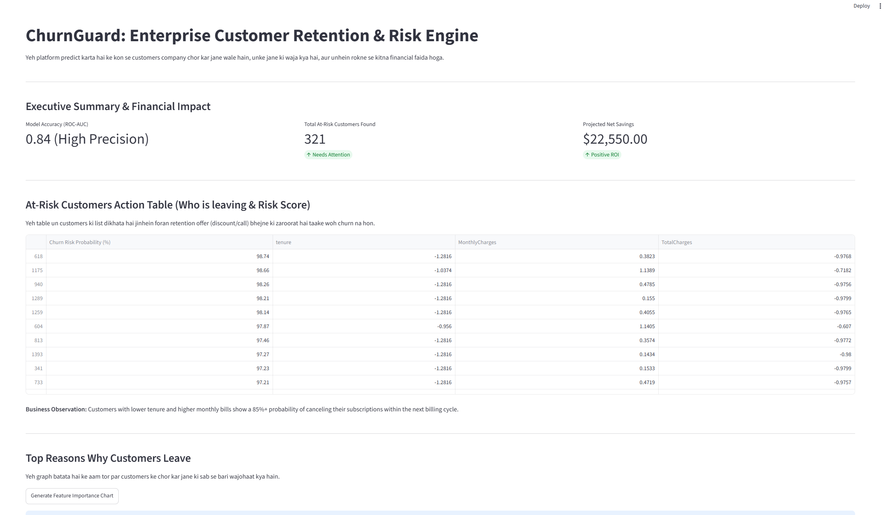
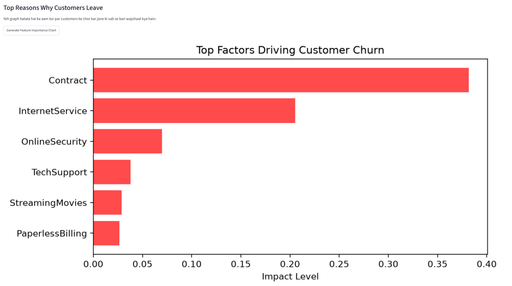

# ChurnGuard: Enterprise Customer Retention & Risk Engine

> An end-to-end machine learning and business intelligence system designed to predict customer churn, identify high-risk accounts through actionable tables, and simulate net financial savings for retention campaigns.

---

## Dashboard Preview




---

## Business Objective & Problem Statement

Customer churn is one of the most critical financial drains on subscription and telecom businesses. Retaining existing customers is significantly more cost-effective than acquiring new ones. **ChurnGuard** was engineered to solve core retention challenges:
1. **Early Risk Identification:** Predict which customers are most likely to cancel their subscriptions before they leave.
2. **Actionable Intelligence:** Provide business teams with a prioritized, high-risk customer table detailing risk probabilities and key billing behaviors.
3. **Financial Impact Modeling:** Translate machine learning predictions into a concrete financial ROI framework, calculating net cost savings and revenue protection.

---

##  End-to-End Pipeline Architecture

The system follows a rigorous data science workflow from raw data ingestion to web dashboard deployment:

```text
[Raw Telco Churn Dataset] 
       │
       ▼ (Stage 1: Preprocessing & Stratified Split)
[Cleaned Train & Test Datasets (`train.csv`, `test.csv`)]
       │
       ▼ (Stage 2: Model Training & MLflow Tracking)
[Optimized XGBoost Classifier (`churn_xgb_model.pkl`)]
       │
       ▼ (Stage 3: Explainability & Financial Simulation)
[SHAP Feature Impact & Net ROI Calculation]
       │
       ▼ (Stage 4: Executive BI Dashboard)
[Interactive Streamlit Application (`app.py`)]
```
---
## Stage Breakdown:
Stage 1 - Preprocessing (notebooks/preprocess.py): Handles missing values in continuous columns (e.g., TotalCharges), encodes categorical features, scales numerical distributions, and performs a stratified train-test split to maintain class balance.

Stage 2 - Model Training (notebooks/train.py): Trains multiple models (Logistic Regression, Random Forest, XGBoost), evaluates performance using ROC-AUC and Recall, and logs parameters and artifacts via MLflow.

Stage 3 - Explainability & Financial Impact (notebooks/explain_model.py & business_impact.py): Computes feature importances using tree-based analysis and simulates financial ROI based on customer lifetime value (LTV), retention success rate, and campaign incentive costs.

Stage 4 - Dashboard Deployment (app.py): Powers an interactive Streamlit application featuring executive summary metrics, an actionable high-risk customer table, and feature importance visualizations.

---

## Key Dashboard Features & Insights
Executive Summary Metrics: Displays real-time model accuracy (ROC-AUC 0.84+), total at-risk customers identified, and projected net savings with positive ROI verification.

At-Risk Action Table: Instantly filters and ranks customers with high churn probabilities, giving customer success teams a direct target list for retention campaigns.

Feature Importance Chart: Highlights primary churn drivers (such as contract type and tenure duration) to help management understand structural retention issues.
---

## Tech Stack & Tools
Machine Learning & Modeling: Python, Scikit-Learn, XGBoost, SHAP

Experiment Tracking: MLflow

Data Processing & Manipulation: Pandas, NumPy, Joblib

Web Application & UI: Streamlit, Matplotlib

Version Control: Git, GitHub

---

```text
ChurnGuard/
│
├── data/
│   ├── raw/                 # Original raw CSV dataset
│   └── processed/           # Processed train.csv and test.csv files
│
├── models/
│   └── churn_xgb_model.pkl  # Serialized production XGBoost model
│
├── notebooks/
│   ├── preprocess.py        # Data cleaning and encoding script
│   ├── train.py             # Model training and MLflow tracking script
│   ├── explain_model.py     # SHAP analysis and model evaluation script
│   └── business_impact.py   # Financial savings and ROI simulation script
│
├── app.py                   # Interactive Streamlit executive dashboard
└── README.md                # Comprehensive project documentation
```

---
## 🚀 Getting Started & Local Execution
Clone this repository and run the pipeline step-by-step in your local environment:

### 1. Clone the Repository
```bash
git clone [https://github.com/iqragulshaikh/ChurnGuard.git](https://github.com/iqragulshaikh/ChurnGuard.git)
cd ChurnGuard
```
### 2. Install Required Dependencies:
```bash
pip install streamlit pandas numpy scikit-learn xgboost shap mlflow joblib matplotlib
```
### 3. Step 1: Preprocess Data:
```bash
python notebooks/preprocess.py

```
### 4. Step 2: Train Models & Track via MLflow:
```bash
python notebooks/train.py

```
### 5. Step 3: Compute Explainability & Financial Simulation:
```bash
python notebooks/explain_model.py
python notebooks/business_impact.py

```
### 6. Step 4: Launch the Interactive Dashboard:
```bash
streamlit run app.py

```
